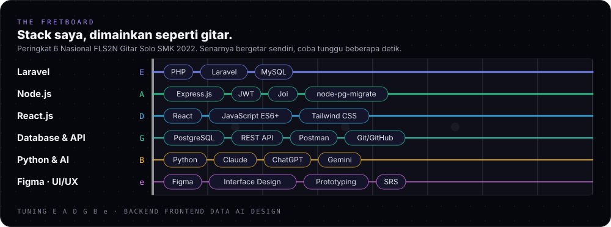

 

**Mahasiswa Teknik Informatika (IPK 3.90)** dari Bontang, berlatar belakang SMK Rekayasa Perangkat Lunak. 
Membangun aplikasi web dan merancang antarmuka.

 

<!-- Tambahkan badge portofolio bila sudah online, ganti URL-nya:

-->

 

## 🎬 Now Showing

<table>
<tr>
<td align="center"> <a href="https://github.com/lReisyaa/Sim-Mahasiswa">Repo ↗</a></td>
<td align="center"> <a href="https://github.com/AchmadGibran/personal-notes-app">Repo ↗</a></td>
<td align="center"> <a href="https://github.com/AchmadGibran/openjob-api">Repo ↗</a></td>
<td align="center"> <a href="https://www.figma.com/proto/ZfZSi4IHV5sUlXfRg2u3Eu/Hadir.in-KHP?node-id=24-41&p=f&viewport=68%2C94%2C0.05&t=nTxAuEXEEhC7JQyR-1&scaling=scale-down&content-scaling=fixed&starting-point-node-id=24%3A41&page-id=0%3A1">Prototype ↗</a></td>
<td align="center"> <a href="https://www.figma.com/proto/xGOzz5ZkFh1gI4CfPineJE/ColorCoded?node-id=187-869&p=f&viewport=557%2C372%2C0.07&t=4Jn5e3MWtlNijThy-1&scaling=scale-down&content-scaling=fixed&starting-point-node-id=187%3A866&page-id=0%3A1">Prototype ↗</a></td>
</tr>
</table>

 

## 🧰 Tech Stack

 

## 🎞️ Learning Reel

 

## 🎥 Behind the Scenes

<b>Di luar bidang utama (klik untuk membuka)</b>

 

- 🎸 **Musik:** Peringkat 6 Nasional FLS2N Gitar Solo SMK 2022, Juara Harapan 3 Nasional Duet Gitar FLS2N SMP 2019, serta beberapa juara tingkat kota dan provinsi.
- 📣 **Digital marketing:** Sertifikasi BNSP Social Media Marketing dan pengalaman TikTok Live Selling dengan 90+ transaksi langsung.
- 🗂️ **Data & arsip:** Records Management & Data Entry di beberapa instansi pemerintahan (2025–2026).
- 🏅 **Akademik:** Siswa Berprestasi Bidang Akademik Peringkat 2 (2024) dan Juara 2 Lomba Ranking Satu Bawaslu Kota Bontang (2025).

 

## 📊 Stats

  

<picture>
  <source media="(prefers-color-scheme: dark)" srcset="https://raw.githubusercontent.com/AchmadGibran/AchmadGibran/output/github-snake-dark.svg"/>
  
</picture>

 

